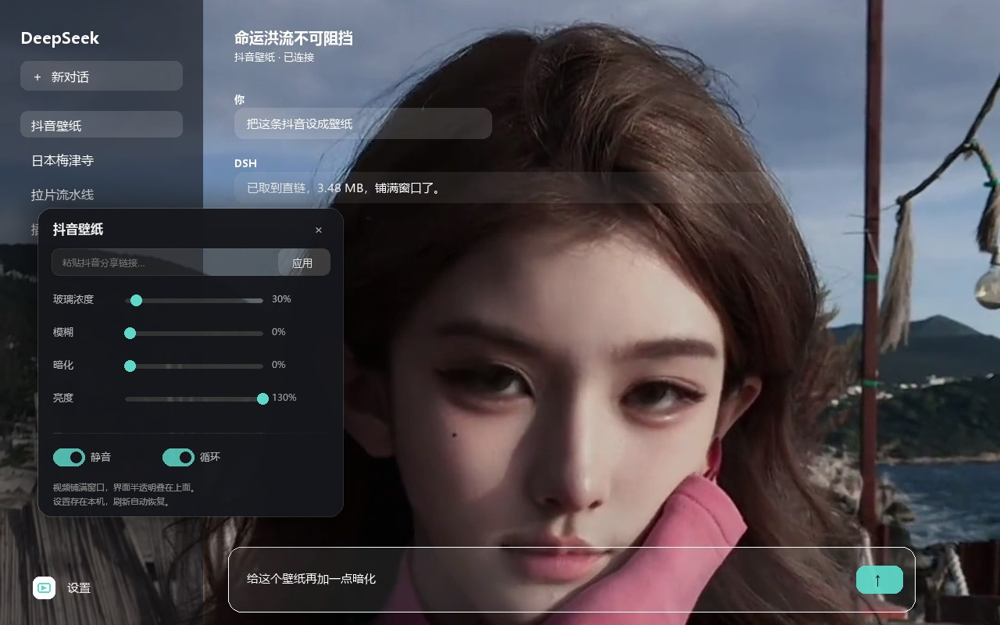

# 抖音壁纸 · Douyin wallpaper

**粘贴一条抖音链接，DSH 的极简界面就变成它的播放背景：视频铺满窗口，界面像磨砂玻璃浮在上面。**



## 装

在 DSH 的 **插件 → 添加插件** 里选这个目录，或：

```
dsh plugin --profile web add link:<这个目录的绝对路径> && dsh plugin --profile web install
```

装完刷新页面，侧栏底部、设置按钮左边会出现一个 ▶ 图标。

## 用

1. 抖音里对作品点「分享 → 复制链接」，复制整段文字（带【作者的作品】那种）；
2. 点 ▶ 打开面板，粘进输入框，回车；
3. 视频会取到直链、下载到本机，然后铺满窗口。首屏大约 15–25 秒（起一次 Edge + 下载）。

面板里：**玻璃浓度**（面板的不透明度，背景只吃它 0.62 倍权重，所以视频保留自己的颜色）、**模糊**、**暗化**、**亮度**、**缩放**，以及静音 / 循环。封面条切换已下载的作品，`✕` 删除，开关临时关掉壁纸。

首次使用默认把视频放到最清楚：亮度最高（130%）、模糊与暗化都是 0、玻璃浓度最低（30%）。觉得文字不够稳，把模糊拉到 6–10、玻璃浓度拉到 60 左右即可。

## 它支持什么

| 输入 | 结果 |
| --- | --- |
| 视频分享链接 | 原生 `<video>` 循环播放 |
| 图文（`/note/`） | 单张缓慢推近；多张每 7 秒交叉淡入 |
| 多视频轮播（`/slides/`） | 取浏览器里第一条可播放的视频 |
| 本机视频绝对路径 | 直接复制进来当壁纸 |

合集、直播、私密作品不支持。

## 媒体怎么拿到

抖音官方接口已对服务端读者关死（分享页 SSR 里 `videoInfoRes` / `noteInfoRes` 都是 `null`，网页版 detail 接口一律 403）。所以：

1. 短链先跟一跳，判断是 `/video/`、`/note/` 还是 `/slides/`；
2. **视频 / 轮播**：优先调用你本机的 `douyin_lapian.py`（playwright 驱动系统 Edge，headless 不触发验证码；从页面自己的 `/aweme/v1/web/` JSON 里取 `video.play_addr`）。桥接脚本在 `tools/lapian_bridge.py`，配置见下；
3. 没配脚本时退回第三方解析接口（默认 `api.xingzhige.com`，`DSH_DWP_PARSE_API` 可换）；
4. **图文**：先试 `DSH_DWP_PARSE_API_ALBUM`，再退到 `Baiduspider` UA 抓 `www.douyin.com/note/<id>`（抖音对爬虫仍会服务端渲染）；
5. 图片真实格式常是 webp，落盘前按文件头判扩展名。

### 配置本地取流脚本

```json
// ~/.dsh-douyin-wallpaper/lapian.json
{ "script": "D:\\…\\douyin_lapian.py", "python": "D:\\…\\.venv\\Scripts\\python.exe" }
```

或环境变量 `DSH_DWP_LAPIAN` / `DSH_DWP_PYTHON`。只给 `script` 时，插件会找它旁边的 `.venv\Scripts\python.exe`。

**配了脚本后，脚本失败就直接报错，不会偷偷转给第三方**（对应「失败即停、不重试」）。想改用解析接口，把 `lapian.json` 挪走即可。

## 数据放在哪

默认 `~/.dsh-douyin-wallpaper`，可用 `DSH_DWP_DATA_DIR` 改：

| 路径 | 内容 |
| --- | --- |
| `state.json` | 启用状态、当前壁纸、外观设置 |
| `lapian.json` | 本地取流脚本的两个路径（可选） |
| `media/<id>.mp4` | 下载的视频 |
| `media/<id>-<n>.<ext>` | 图文作品的第 n 张 |

整个目录随时可删。

## 边界

- 抖音 CDN 直链有有效期（约一个月），所以先落盘再播放；同一条重复导入会按规范页 URL 去重，不重复下载。
- 视频上限 240 MB，图文每张 16 MB、最多 35 张。
- 壁纸只在 `dsh web` 与桌面版的网页界面里生效。
- 不注册 Tool、不注入提示词、不写会话，对模型零 token 开销。
- 取流方法（含实测否证与坑位）整理在 [douyin-api-bypass](https://github.com/yangyanlu06/douyin-api-bypass)，桥接脚本两边同一份。
